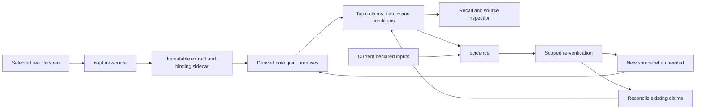

# Guide: Shared project memory and software evidence

For maintainers changing discovery, capture or validator integration. Installed
`memory.md` owns agent usage; the software-knowledge ADR records the design choice.
This guide maps implemented controls and their limits, not semantic correctness.

## Control and data flow
[source: shared-project-memory-software-evidence.md#skills/agentic-sdlc-skill/scripts/knowledge.py:kb_capture_source]
[source: shared-project-memory-software-evidence.md#skills/agentic-sdlc-skill/scripts/knowledge.py:kb_software_findings]

Capture writes no claims or extraction-complete field. Distillation, placement and
reconciliation remain agent work under the owning lens. A snapshot is evidence of
selected bytes, not proof that their interpretation or coverage is complete.

## Discovery and freshness
[source: shared-project-memory-software-evidence.md#skills/agentic-sdlc-skill/scripts/knowledge.py:memory_records]
[source: shared-project-memory-software-evidence.md#skills/agentic-sdlc-skill/scripts/knowledge.py:memory_recall]
[source: shared-project-memory-software-evidence.md#skills/agentic-sdlc-skill/scripts/knowledge.py:memory_validate]

Index catalogs README and Markdown originals from MEMORY_DIRS, excluding generated
indexes, hidden/harness directories, raw corpus, code and audit. Rows carry metadata
and raw-byte fingerprints, not work states. Domain defaults from README, then code.
Recall searches live metadata with all query words; it does not search bodies.
A missing result proves no metadata match. Open the originals and inspect evidence.
An existing stale catalog is detected; legacy absence stays usable until index.
No watcher or automatic extraction is introduced. Guide snapshot hashes establish
snapshot freshness only, never correspondence with subsequently edited live code.

## Capture safety and identity
[source: shared-project-memory-software-evidence.md#skills/agentic-sdlc-skill/scripts/knowledge.py:_kb_read_bytes]
[source: shared-project-memory-software-evidence.md#skills/agentic-sdlc-skill/scripts/knowledge.py:_kb_capture_lock]
[source: shared-project-memory-software-evidence.md#skills/agentic-sdlc-skill/scripts/knowledge.py:_kb_project_id]
[source: shared-project-memory-software-evidence.md#skills/agentic-sdlc-skill/scripts/knowledge.py:kb_capture_source]

Capture accepts one explicit UTF-8 span from a regular file of at most 16 MiB.
It rejects escaping/drive/ADS paths and symlinks/reparse points in existing path hops.
A single byte buffer supplies extract and full-file digest; stat checks detect
ordinary concurrent modification. The docs-root README owns a persistent UUID.
Capture serializes cooperating writers, publishes without overwriting, and writes
the sidecar last. An identical retry reuses evidence; an orphan blob can be completed.
An abandoned lock requires inspection before removal. These are trusted-workspace
controls, not protection against adversarial concurrent directory replacement or
an attacker restoring timestamps; the UUID is identity metadata, not authentication.

## Claims and evidence are separate contracts
[source: shared-project-memory-software-evidence.md#skills/agentic-sdlc-skill/scripts/knowledge.py:kb_check_claims]
[source: shared-project-memory-software-evidence.md#skills/agentic-sdlc-skill/scripts/knowledge.py:_kb_software_integrity]
[source: shared-project-memory-software-evidence.md#skills/agentic-sdlc-skill/scripts/knowledge.py:kb_software_findings]
[source: shared-project-memory-software-evidence.md#skills/agentic-sdlc-skill/scripts/knowledge.py:kb_cmd_evidence]

Legacy eight-column rows keep their IDs. Schema 2 adds kind: OBSERVATION,
REQUIREMENT, HYPOTHESIS or DESIGN, independently of provenance and state.
Cross-kind CONTESTED/SUPERSEDED relations are rejected. Legacy nature stays
UNCLASSIFIED until source-based classification; approval never implies observation.

Evidence verifies binding metadata and stored bytes before comparing declared live
files. AND combines all transitive derivation premises; OR keeps alternative claim
supports separate. MATCHED is byte correspondence, CHANGED requests re-verification,
UNAVAILABLE identifies unreadable/missing inputs, UNBOUND a different/absent project
identity, UNTRACKED a source without live binding, INVALID an integrity failure.
Unbound paths are not opened as local software. Stale alternatives remain visible
even if another matches. Claim state remains separate. Explicit evidence exits 1 on
integrity errors, unclassified/non-OK rows or an observation with no matched support;
other claim kinds need not pretend to be executable evidence. No-coverage is stated.

## Composition and portability
[source: shared-project-memory-software-evidence.md#skills/agentic-sdlc-skill/scripts/knowledge.py:kb_validate_surface]
[source: shared-project-memory-software-evidence.md#skills/agentic-sdlc-skill/scripts/knowledge.py:kb_cmd_check]
[source: shared-project-memory-software-evidence.md#skills/agentic-sdlc-skill/scripts/knowledge.py:kb_export_closure]
[source: shared-project-memory-software-evidence.md#skills/agentic-sdlc-skill/scripts/knowledge.py:kb_import_plan]
[source: shared-project-memory-software-evidence.md#distributions/mkt-agentic-sdlc/skills/mkt-agentic-sdlc/scripts/mkt_check.py:main]
[source: shared-project-memory-software-evidence.md#distributions/course-creator/skills/course-creator/scripts/sdlc_check.py:main]

Code/KB compose core, memory, graph, corpus and evidence diagnostics. Marketing
passes its resolved project to the shared seam and retains its numerical checks;
course adds its instructional validator. Drift warns in existing check/stale;
integrity errors fail check. Use final exit and all findings, not an earlier core
CLEAN banner. Legacy/non-software work receives no new binding requirement.

Export includes cited sources and transitive derivation premises, refusing missing,
escaping or cyclic closures. Additive import preserves bindings and ignores the
exporter's README; it does not adopt identity or rewrite foreign ruling authority.
Preflight is not a filesystem transaction. The receiving agent applies the existing
IMPORTED/re-ratification policy and runs check. Root ambiguity is never resolved by
combining projects. Concept graphs do not replace symbol/dependency impact analysis.
