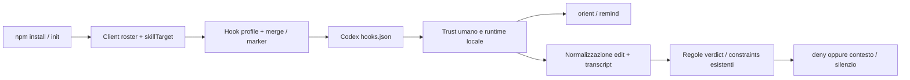

# Analysis: Codex hook parity

Per il proprietario che approva il comportamento e per chi implementerà la modifica. Decide installazione, compatibilità degli eventi e prove richieste; non attiva hook o autorizzazioni sul profilo reale. Budget del documento: 300 righe, esclusi eventuali risultati generati.

Level: L3 · router: `GUIDE_skill_family_changes.md` → read.
Modalità Standalone: devPNT è collegato a chatPNT, non a questo repository. Fonte: `audit/requests/REQUEST_codex_hooks.md#R1`.

## Objective

Chi installa o aggiorna `@antoneeo/agentic-sdlc-skill` ottiene in Codex locale gli stessi quattro hook configurati per Claude Code, e istruzioni corrette per autorizzarli. Le verifiche devono comprendere gli eventi Codex: una configurazione che viene caricata ma rimane silenziosa non soddisfa il requisito.

Elicitation: skip path per obiettivo/perimetro, definiti da R1 e dalla parità con il pacchetto attuale. Installare automaticamente una definizione non autorizza il trust Codex: tale decisione rimane all'utente. Nessuna Vision viene modificata.

## Feature Vision

`vision/project_vision.md`, APPROVED v9: Goal «Be installable, upgradable and maintainable […] on the clients they already run, without hand-assembly»; attori Solo developer e Team lead. Migliora l'installabilità e la visibilità delle omissioni. La Vision ammette esplicitamente l'adattamento ai formati dei client.

L'estensione di r34 e r39 da Claude a Codex aggiunge un costo ai turni/edit Codex, prima pari a zero: non si eredita automaticamente la loro approvazione. Costi proposti da approvare con il design: stessa riga `remind` (<600 caratteri) per prompt; `orient` con il tetto esistente di 9.500 caratteri a SessionStart; due invocazioni del validator per patch (ogni invocazione usa un wrapper Python più il validator: quattro processi totali), senza nuovo check su Bash; recall entro 15 righe complessive. Latenza Codex ancora da misurare, non si spaccia la misura Claude per Codex. Nessun nuovo artefatto o rito manuale per L1, oltre al trust richiesto dal client. Il precedente r34 dichiarava costo zero sugli altri client: questa è una sua estensione esplicita, da registrare nel ledger solo dopo la decisione del proprietario.

Non-obiettivi: nuovo hook `Stop`, enforcement su ogni scrittura shell, modifica di Gemini/Antigravity, bypass di trust o policy amministrative, nuova dipendenza npm/Python, migrazione F-082, nuovo servizio. L'auto-wiring Node riguarda il pacchetto software principale; i tre sibling conservano i propri installer e il proprio set di hook (oggi solo orient). Le copie condivise Python mantengono la stessa semantica.

## Evidence and probes

Evidenze del 2026-11-04; baseline Git `74c1833f`, package 1.52.0, Windows, Node 24.14.0, Python 3.14.3. Il binario desktop locale riporta `codex-cli 0.166.0-alpha.6`, `features list`: `hooks stable true`. Questo non dimostra che gli hook stiano girando nella chat attuale.

| ID | Claim verificata | Prova eseguita |
|---|---|---|
| E1 | Postinstall copia la skill Codex ma configura quattro handler solo per Claude. | `harness_codex_hooks/probe_install.cjs`: file realmente distribuibili del package copiati in una cartella temporanea, HOME e tutte le home client isolate; Codex skill=true, Codex hooks=false, Claude handlers=4. |
| E2 | Il validator attuale non interpreta `apply_patch` o il transcript Codex. | `probe_events.py`: Claude senza router → rifiuto; stesso caso con apply_patch → silenzio; transcript `response_item/message/output_text` → zero assistant, `transcript_work` zero assistant. |
| E3 | Un orient hook globale Codex non viene rilevato. | `probe_events.py`: hooks.json temporaneo valido e CODEX_HOME isolato → `orient_hook_state=unwired`. |
| E4 | I controlli riescono a FALLIRE. | Entrambe le sonde con `--assert-parity` terminano con exit 1. Senza flag verificano il difetto e i controlli positivi, exit 0. |
| E5 | I test esistenti non rilevano questa lacuna. | `test_verdict.py`: 41/41; `test_constraints.py`: 70/70, prima di ogni modifica produttiva. |

Le forme Codex sono state osservate ispezionando solo tipi e nomi delle chiavi del transcript di questa sessione: messaggi assistant `response_item` e chiamate wrapper `custom_tool_call` di nome `exec`. Nessun contenuto privato è copiato nelle fixture. La sonda E2 usa una fixture sintetica con la stessa forma.

Riferimento esterno, verificato il 2026-11-04: [OpenAI Hooks](https://learn.chatgpt.com/docs/hooks). Contratti del client: JSON utente/progetto e TOML vengono sommati; hook non gestiti richiedono trust della definizione; `apply_patch` porta la patch in `tool_input.command`; transcript non è un'API stabile. L'esecuzione di script locali richiede orchestrazione locale; non è disponibile nell'orchestrazione cloud anche quando alcuni tool eseguono localmente. Questi sono vincoli del client, non proprietà dedotte dalla nostra sonda.

## Use Cases / User Needs

- **UC1 — Solo developer:** installare/aggiornare il pacchetto, autorizzare gli hook nel client e ottenere orientamento/promemoria senza assemblare JSON a mano. Nomi EXISTS: installer npm, Codex `/hooks`, comandi `orient`, `remind`, `verdict`, `constraints`.
- **UC2 — Solo developer:** prima di una patch, essere fermato se manca la dichiarazione/router richiesta, e ricevere i vincoli pertinenti quando opera su un'unità L3. EXISTS: `apply_patch`, ANALYSIS, guide router; NEW: adattamento degli eventi Codex nel validator.
- **UC3 — Team lead:** mantenere opt-out, hook propri e controlli Claude durante upgrade/rimozioni, distinguendo configurazione da esecuzione dimostrata. Non viene introdotta una console o un nuovo gestore del lavoro.

## Functional Spec

- **FS1:** dopo installazione riuscita del pacchetto, Codex rilevato e Python disponibile, creare/integrare `$CODEX_HOME/hooks.json` (default `~/.codex`), preservando le chiavi estranee. Quattro handler: SessionStart/orient, UserPromptSubmit/remind, PreToolUse/verdict e PreToolUse/constraints. Il comando configurato resta valido anche quando Codex parte da una sottocartella del progetto.
- **FS2:** la seconda installazione identica non cambia la definizione, non duplica gli handler e non riscrive inutilmente il file. Ciascun hook conserva il proprio opt-out per target. Disabilitato/rimosso dall'utente non significa «da riparare». Un handler diverso o non attribuibile non viene sovrascritto.
- **FS3:** il messaggio d'installazione dice «configurato; verifica/autorizza in /hooks», mai «attivo». Non modifica trust, `features.hooks`, policy gestite o permessi. Un ambiente senza supporto di hook locali riceve un limite esplicito e mantiene la skill testuale.
- **FS4:** il profilo Codex intercetta `apply_patch` sul percorso hook nativo; esamina tutti i path Add/Update/Delete e entrambi i path Move. Per una patch con più file un solo requisito mancante basta al rifiuto; il recall condivide un tetto globale di 15 righe. Nessun cambio alla policy fail-open su formato sconosciuto, transcript inaccessibile/oversize e subagent riconosciuto. Nessun output `allow`.
- **FS5:** il transcript Codex riconosciuto alimenta gli stessi criteri Claude (dichiarazione, guide nominate/read-hints, ultimo livello, documenti dell'unità toccati). La presenza di un file nei parametri è un read-hint secondo il criterio già esistente, non prova della lettura integrale. Testo user/tool output e reasoning non possono dichiarare il router.
- **FS6:** `init` considera Codex per orient e non aggiunge un secondo handler quando ne vede uno globale/progetto risolvibile. Le configurazioni utente e di progetto già presenti devono essere considerate prima di scrivere; init configura Codex al livello utente quando manca un hook equivalente. Policy o parsing non verificabili: lasciare intatto, riferire la limitazione, nessun falso «already active».
- **FS7:** la rimozione esplicita supportata dal pacchetto elimina solo handler attribuibili alle skill rimosse, anche nei target CODEX_HOME storici dei marker. L'eventuale opt-out senza entry sopravvive. Npm 11 può non eseguire preuninstall (F-082 E9): non si promette pulizia automatica di `npm uninstall`; ENFORCEMENT documenta l'esecuzione esplicita prima della rimozione del package. Nuovo binario pubblico di uninstall escluso.
- **FS8:** Claude resta funzionalmente equivalente; si preservano le installazioni dei sibling e i loro file personali. L'orient diagnostico riporta il client e la risolvibilità, senza certificare trust o copertura completa dei tool.

## Interface Contract

**IC1 (UC1):** npm/install-skill → installazione skill → ispezione dei target hook → merge idempotente → resoconto per hook (configured, already configured, opted-out, broken, conflict/unverified, no-python, write-failed). Segue il passo umano `/hooks`, con la definizione mostrata da Codex. Un successivo cambiamento della definizione può richiedere nuovo trust.

**IC2 (UC2):** evento PreToolUse → normalizzazione dell'edit e transcript → regole esistenti verdict/constraints → deny circostanziato oppure context-only/silenzio. Un rifiuto dice cosa manca e come riprovare; un errore interno non viene trasformato in un'approvazione. Gli hook concordanti possono partire in parallelo: il recall non presuppone che verdict lo preceda.

**IC3 (UC3):** init/check → ispezione fonti per client → configurato/assente/morto/non verificabile. Nessuna cancellazione implicita di fonti manuali. La rimozione esplicita passa dallo stesso criterio di attribuzione del writer; il ciclo non modifica lo store di trust.

## Capability Ledger

| Capacità | Verdetto | Proprietario e gap |
|---|---|---|
| Installare e individuare la skill | EXISTS | `scripts/lib.js:CLIENTS`, `clientDetected`, `skillTarget`; E1 ne verifica il ramo Codex. |
| Collegare hook e conservare opt-out | INADEQUATE | `wireGlobalOrientHook`, `wireGlobalCommandHook`, marker e pruning in lib.js: target/filtro Claude; non duplicare il meccanismo. |
| Interpretare eventi e transcript | INADEQUATE | `sdlc_core.py:transcript_facts`, `transcript_work`, `verdict_reason`, `constraints_hook_context`; E2. Estendere il componente esistente con un normalizzatore. |
| Rilevare configurazione per client | INADEQUATE | `_orient_hook_commands`, `orient_wiring`; E3. Nessuna verifica del trust disponibile da questi file. |

## Guide check

Il router aveva solo la guida sulle copie della famiglia; nessuna guida CURRENT descriveva il componente hook. `reference/GUIDE_hooks.md` conserva il modello attuale, con ancore al codice e alle sonde; va aggiornato alla consegna dell'implementazione. Non descrive come già presente il comportamento qui progettato.

## Impact

### Module Change Plan

| Path | Intervento, firme e integrazione |
|---|---|
| `scripts/lib.js` | MODIFY. Nuovi helper privati `hookProfile(client) -> object|null`, `codexHookEquivalent(spec, group, handler, command, invocation) -> bool`, `hookSources(options) -> {sources, targets}|{error, target}`, `hookHandler(spec, client, python, validator) -> object`, `decodeHookInvocation(command) -> {validator, argv, client}|null`. Aggiornare `orientHookValidator(command)`, findOrientHook e findCommandHook per riconoscere il wrapper deterministico oltre al legacy. Estendere senza cambiare le firme esportate `wireGlobalOrientHook(options)`, `wireGlobalCommandHook(spec, options)`, `wireOrientHook(options)`, `removeGlobalHookEntries(removedRoots, spec)`. Il profilo sceglie settings.json Claude / hooks.json Codex, matcher e formato; i marker restano per hook+target. Tutte le path verso validator passano da skillTarget. |
| `scripts/postinstall.js` | MODIFY. `installSkill(client)` invariata come contratto; chiamare il wiring per i client supportati dal profilo dopo copia riuscita, una sola probe Python; resoconto accurato per ogni hook; statusMessage nel builder Codex spiega lo scopo anche nel consenso desktop. Non trasferire lo stesso blocco nei caller. |
| `scripts/init.js` | MODIFY. Sostituire la selezione claudeClient/otherClients per orient con iterazione dei profili supportati, conservando i messaggi e il seeding idempotente. Codex configura solo il livello utente quando manca una fonte equivalente; nessun nuovo hook Codex locale di progetto. |
| `scripts/test_clients.js` | MODIFY. Casi parametrizzati Claude/Codex per wiring, marker, opt-out, errore, upgrade e rimozione esplicita; ogni home e marker isolato, compreso CODEX_HOME. |
| `skills/agentic-sdlc-skill/scripts/sdlc_core.py` | MODIFY. Nuovi helper `hook_edits(payload) -> list[dict]|None`, `transcript_events(path) -> iterator`, `shell_read_paths(command, cwd, workdir=None) -> list[str]|None`: normalizzano path/new_text e messaggi/tool-input, senza eseguire input. `transcript_facts(path)`/`transcript_work(path)` conservano firma e risultato; `verdict_reason(payload, root=None, docs_name=None)` e `constraints_hook_context(payload, root=None, docs_name=None)` usano tutti gli edit. `_orient_hook_commands(root)` conserva tuple ma usa un'etichetta client esplicita per i target globali. `orient_wiring(root)` conserva la forma per client; `print_orient_hook_note(root)` e `cmd_orient(args)` distinguono le definizioni Codex disabilitate/non verificabili e non promettono consegna del contesto dai conteggi. `_orient_entries_in(p)` e `_orient_entry_live(root, cmd, at_user_level)` decodificano anche il wrapper generato; helper privati `_codex_hook_config(root) -> {policy, disabled_entries}` e `_decode_hook_invocation(command) -> dict|None` con lo stesso schema e fixture del decoder JS. |
| `skills/agentic-sdlc-skill/scripts/test_verdict.py` | MODIFY. Fixture Codex con dichiarazione assente/presente, guida letta/non letta, record falsificati user/tool, patch multipath e move, payload ignoti. |
| `skills/agentic-sdlc-skill/scripts/test_constraints.py` | MODIFY. Stesse popolazioni Codex, unità toccata/estranea, L1/L3, budget cumulativo patch, subagent, wrapper riconosciuto/ignoto. |
| `skills/agentic-sdlc-skill/scripts/test_session_start.py` | MODIFY. Fonti globali Codex/Claude separate, doppioni, morti, override home, limiti di output e diagnosi che non dichiara trust. |
| `skills/agentic-sdlc-skill/scripts/test_golden_regression.py`, `distributions/kb-agentic-skill/skills/kb-agentic-skill/scripts/test_golden_regression.py`, `distributions/mkt-agentic-sdlc/skills/mkt-agentic-sdlc/scripts/test_golden_regression.py` | MODIFY. In `run_corpus()`, isolate CODEX_HOME in the subprocess fixture environment alongside existing user-settings and skill-directory seams; preserve the frozen golden baseline. `test_session_start.py::setUpModule()/tearDownModule()` isolate and restore CODEX_HOME for all orientation tests, with explicit Codex-case overrides preserved. No runtime change. |
| `skills/agentic-sdlc-skill/scripts/test_skill_invariants.py` | MODIFY. Aggiornare solo gli assert sulle promesse di wiring Codex e sulle nuove firme interne, senza alterare le regole di triage. |
| `skills/agentic-sdlc-skill/ENFORCEMENT.md` | MODIFY. Configurazione automatica Codex locale, trust umano, stato verificabile, limiti cloud/vecchi client, opt-out e rimozione esplicita; togliere la promessa che Codex resta sempre manuale. |
| `skills/agentic-sdlc-skill/SKILL.md` | MODIFY. Aggiornare il paragrafo Operative Guides/Rule Zero che dichiara enforcement solo Claude: includere Codex locale supportato dopo trust; conservare il percorso manuale negli ambienti non coperti. I sibling non ereditano la nuova promessa di auto-wiring. |
| `ai_docs/strategic/skill_family_agent_workflows.md` | MODIFY. Rigenerare dalla dottrina cambiata la descrizione derivata degli hook, distinguendo il pacchetto principale e gli installer sibling; duty del piano audit. |
| `skills/agentic-sdlc-skill/scripts/shared_manifest.json` e le tre copie sotto le root scripts della tabella seguente | GENERATED dal tool shared_files.py dopo sincronizzazione delle copie; nessuna modifica manuale dei digest. |
| `README.md` | MODIFY. Descrivere cosa avviene all'installazione e il solo passo umano richiesto dal client; niente falsa attivazione universale. |
| `ai_docs/strategic/architecture.md` | MODIFY a implementazione conclusa: aggiornare le righe Hook wiring/Validator core, citare la guida e i vincoli di questo disegno. |
| `ai_docs/reference/GUIDE_hooks.md` | ADD ora per l'as-is; MODIFY a implementazione conclusa con il comportamento verificato. |

Copie condivise, da modificare nella stessa implementazione: soltanto il core Python e le quattro batterie relative, mantenute identiche. Non copiare lib.js tra i package: i loro installer hanno contratti diversi.

| Root concreta | File concreti sotto la root da sincronizzare |
|---|---|
| `distributions/kb-agentic-skill/skills/kb-agentic-skill/scripts/` | `sdlc_core.py`, `test_verdict.py`, `test_constraints.py`, `test_session_start.py`, `test_skill_invariants.py` |
| `distributions/mkt-agentic-sdlc/skills/mkt-agentic-sdlc/scripts/` | `sdlc_core.py`, `test_verdict.py`, `test_constraints.py`, `test_session_start.py`, `test_skill_invariants.py` |
| `distributions/course-creator/skills/course-creator/scripts/` | `sdlc_core.py`, `test_verdict.py`, `test_constraints.py`, `test_session_start.py`, `test_skill_invariants.py` |

Le prove/registri di questa fase sono `audit/requests/REQUEST_codex_hooks.md`, `solutions/harness_codex_hooks/{probe_install.cjs,probe_events.py}`, questo ANALYSIS e `audit/HANDOFF_codex_hooks.md`. E2E_TEST, MERGE_REVIEW, ADR e aggiornamento rulings sono dovuti alla futura implementazione/decisione, non vengono fabbricati come risultati già consegnati. Indici generati da index, mai a mano.

### Integration & Data Flow

### Technical decisions

**D1 — Configurazione:** usare hooks.json, non riscrivere TOML. Prima del merge ispezionare JSON e TOML utente/progetto. TOML tramite subprocess Python `tomllib`, JSON via parser nativo; non interpretare TOML con una regex. Se tomllib non è disponibile e config.toml esiste, restituire `unverified`, preservare tutto e dare istruzioni manuali: nessuna dipendenza nuova o falsa assenza. Marcatura per-hook del target anche quando una definizione attribuibile viene trovata in TOML, per rispettarne la successiva rimozione. Entry inline: non migrare né riparare automaticamente. L'ispezione non può enumerare tutta la policy gestita/plugin: nessuna promessa di dedup globale contro fonti non leggibili.

**D2 — Init:** per Codex soltanto configurazione utente, con path assoluta al validator installato e fonti utente/progetto ispezionate prima del merge. Niente nuovo hook di progetto o relativo. Senza skill installata rimandare al comando install-skill, senza inventare un percorso eseguibile. Una fonte manuale relativa è qualificabile come risolvibile solo se la sua risoluzione a runtime è verificabile: esistenza sotto la root da sola non certifica esecuzione da una sottocartella. Conservare il ramo progetto Claude invariato. Preferisco il livello utente alla risoluzione aggiuntiva della root nel wrapper: chiude l'esigenza npm e init, senza un nuovo ramo dipendente dal cwd. La prova di install/init deve avviare gli handler con cwd sia root sia src/.

**D3 — Trasporto:** handler Codex con comando nativo sicuro e nessuna dipendenza da `; exit 0` della shell Claude. Aggiungere al builder un wrapper Python stdlib `-c` con preambolo fisso, marker `agentic-sdlc-hook-v1` e payload base64(JSON {client, validator, argv}); il solo dato inserito dopo il preambolo è base64, non una path interpolata nella shell. Il wrapper decodifica il payload e usa `subprocess.run([sys.executable, validator, subcommand, ...], input=stdin_bytes)`, inoltra lo stdout del validator e normalizza l'errore operativo a exit 0; preserva il JSON deny. Il wrapper non costruisce una shell, non evalua payload e usa quoting distinto per POSIX/Windows; la sua stringa è deterministica. Il reader di attribuzione deve riconoscere ESATTAMENTE il wrapper generato, con validator esplicito nel payload decodificato: non dichiararlo foreign/unverifiable dopo averlo scritto. Per orient mantenere il cap esistente; profilo Codex `additionalContextLimit=0` solo con quel cap effettivo, senza rimuoverlo. Nessun `async`.

**D4 — Eventi:** `hook_edits` riconosce Claude e patch Codex complete, risolve i path relativi al cwd del payload e valuta ogni progetto interessato con hook_project. Patch sconosciuta/incompleta: nessun edit parzialmente certificato. `transcript_events` normalizza Claude e Codex `response_item` (message assistant/output_text, function_call con arguments JSON, custom_tool_call apply_patch); preserva i limiti byte/riga e i flag subagent. Per wrapper `exec`, supportare soltanto la grammatica letterale non eseguibile osservata: chiamate `tools.exec_command` con oggetto contenente `cmd`/`workdir` stringa JSON, in `await` e `text(await ...)`, anche in blocchi multipli; ignorare il wrapper intero in presenza di chiamate non riconosciute. Testare fixture sintetiche del wrapper usato in questa sessione. Mappare gli input shell riconosciuti con helper privato `shell_read_paths(command, cwd, workdir=None) -> list[str]|None`: accettare solo comandi completi `Get-Content` (con opzionali -LiteralPath/-Path, -Raw o -TotalCount numerico) e `cat` (opzionale --), con argomenti path letterali quotati o token sicuri. Niente variabili, interpolazioni, sostituzioni, redirect o pipeline; sintassi diversa → None, senza guessed path. Risolvere rispetto al workdir letterale della chiamata, altrimenti al cwd host del payload/sessione. Nella trascrizione tenere il cwd dei record/session metadata; non sostituirlo col cwd corrente se lo storico non lo rende ricostruibile. Le path risultanti alimentano `transcript_work.touched`; la dichiarazione assistant alimenta il livello. Test obbligatorio end-to-end: L3 → wrapper letterale Get-Content di ANALYSIS (anche path relativa con workdir) → patch di file vincolato → recall non vuoto. La stessa estrazione fornisce read-hints per GUIDE; tool con input non riconosciuto resta non verificabile. Non inferire letture da risultati dei tool o da testo arbitrario. La semantica read-hint resta quella Claude, non una nuova certificazione di comprensione.

**D5 — Diagnosi:** estendere l'inventario fonti con `CODEX_HOME/hooks.json` e config.toml oltre ai target progetto; non fondere i client nell'etichetta generica user settings. `configured` significa definizione risolvibile, non trusted/active. Rispettare `features.hooks=false` e `allow_managed_hooks_only` quando osservabili; i limiti runtime si dichiarano senza alterare la policy. Versione minima supportata ancora da fissare con prove, non dedotta dalla versione installata.

### State Model

Stato per hook e target; non introdurre stati operativi di task o un nuovo file di work management.

| Stato letto | Evento | Guardia | Stato/esito | Effetto |
|---|---|---|---|---|
| assente, marker assente | install/update | Python/validator/fonti verificabili | configured, trust non noto | scrive handler e marker |
| assente, marker presente | install/update/init | opt-out | opted-out | nessuna scrittura |
| presente attribuibile e risolvibile | install/update/init | definizione identica | configured esistente | non riscrive; registra marker mancante |
| presente disabilitato | install/update/init | scelta utente | opted-out | non riabilita |
| presente morto o non attribuibile | install/update/init | richiede decisione umana | broken/unverified | non sostituisce |
| JSON/TOML malformato o policy non verificabile | install/update/init | parsing non sicuro | conflict/unverified | preserva, messaggio circostanziato |
| configured | trust/revoca nel client | atto umano | trusted/untrusted nel client | installer non modifica lo store |
| presente attribuibile | remove esplicito | validator dentro root rimosso | assente | rimuove solo quell'handler; libera marker attribuito |
| assente con marker | remove esplicito | già rimosso dall'utente | opted-out persistente | conserva marker |
| qualunque | tentativo auto-trust/override policy | sempre vietato | rejected | nessun cambiamento |

### Preservation constraints

| id | bound to | callers | must stay true | evidence |
|---|---|---|---|---|
| P1 | `scripts/lib.js::CLIENTS`, `scripts/lib.js::skillTarget` | postinstall, init, preuninstall, test_clients | Un solo resolver dei percorsi; nessuna anticipazione della migrazione F-082. | E1; text_references.txt |
| P2 | `scripts/lib.js::wireGlobalOrientHook`, `scripts/lib.js::wireOrientHook`, `scripts/lib.js::removeGlobalOrientHooks` | postinstall/test_clients; init/test_clients; preuninstall/test_clients rispettivamente | Opt-out per target, preservazione delle configurazioni altrui, firme pubbliche retrocompatibili. | E1; text_references.txt |
| P3 | `scripts/lib.js::wireGlobalRemindHook`, `scripts/lib.js::wireGlobalVerdictHook`, `scripts/lib.js::wireGlobalRecallHook`, `scripts/lib.js::removeGlobalCommandHooks` | postinstall/test_clients; preuninstall/test_clients per remove | Marker distinti; nessun raddoppio o ampliamento del permesso; uninstall attribuito per root. | Test clients esistenti; text_references.txt |
| P4 | `skills/agentic-sdlc-skill/scripts/sdlc_core.py::transcript_facts`, `skills/agentic-sdlc-skill/scripts/sdlc_core.py::transcript_work` | verdict_reason; constraints_hook_context; relativi test diretti | Claude conserva il proprio comportamento; user/tool output non diventano dichiarazioni assistant. | E2, E5; text_references.txt |
| P5 | `skills/agentic-sdlc-skill/scripts/sdlc_core.py::_orient_hook_commands`, `skills/agentic-sdlc-skill/scripts/sdlc_core.py::orient_wiring`, `skills/agentic-sdlc-skill/scripts/sdlc_core.py::orient_hook_state` | orient_wiring/orient_hook_state; cmd_orient/print_orient_hook_note; test_session_start/test_skill_invariants | La diagnosi distingue client, assenza, morto e non verificabilità; nessuna attestazione di trust. | E3; text_references.txt |
| P6 | `skills/agentic-sdlc-skill/scripts/sdlc_core.py` e copie esplicitate nella mappa | entry point software, KB, marketing e Course | Copie condivise identiche; entry point+core+knowledge sufficienti senza nuovi file runtime obbligatori. | Contratti delle entry point; futura prova hash sulle quattro copie |

Enumerazione: server semantico devPNT disponibile solo per chatPNT, quindi non usato per certificare questo repository. Fallback dichiarato: rg sul set `git ls-files` di scripts e Python, seguito da letture mirate; nessun conteggio totale dei consumer viene certificato. Il perimetro testuale comprende 11 JS scripts e 30 Python della skill principale; le copie sono esplicitate sopra. Prima di implementare rigenerare l'inventario per ogni simbolo cambiato con grafo locale se disponibile e coverage-probe testuale. Inventario completo dei riferimenti testuali della baseline in `harness_codex_hooks/text_references.txt` (include definizioni/import/export, non è un grafo). Un consumer dimenticato può perdere wiring, recall o compatibilità delle entry point.

Popolazioni a riposo: profili senza hook; hook Claude esistenti; hook Codex manuali JSON/TOML, disabilitati o rimossi; marker storici; hook che puntano a sibling; vecchi client senza hook; skill legacy/F-082. Nessun backfill dati applicativo. Configurazioni manuali e opt-out restano intatti; la prima installazione aggiornata può aggiungere i soli handler mancanti consentiti. La rimozione di un sibling che forniva l'unico orient può lasciare gli altri senza orient: residuo preesistente, diagnosticato ma nessun nuovo trasferimento automatico di ownership in questa unità.

## Security and Threat Model

| ID | Minaccia | Requisito verificabile |
|---|---|---|
| T1 | autorizzazione implicita o bypass delle policy | FS3: nessuna scrittura trust, allow, feature enable o managed policy; test diff del profilo. |
| T2 | cancellazione di hook estranei/opt-out | FS2/7: attribuzione esatta, marker, merge conservativo, prove con target storici e sibling. |
| T3 | input patch/transcript eseguito o letto senza limiti | FS4/5: parser non eseguibile, limiti esistenti, fake user/tool non validi, malformed fail-open. |
| T4 | hook morto blocca tutti gli edit | D3 wrapper fail-open operativo, stderr non sensibile; deny JSON valido preservato, mai allow. Test missing script/interpreter, downgrade e timeout. Interpreter assente non può essere neutralizzato dal wrapper: Codex deve trattarlo come errore operativo, da provare live. |
| T5 | patch multipath aggira un vincolo o moltiplica il contesto | FS4: tutti i target e move; budget cumulativo, niente path parziali accettati. |
| T6 | falsa sicurezza per trust/cloud/transcript ignoto | FS3/8, D5: stato configurato distinto dall'esecuzione; limiti espliciti, prova live per runtime che dichiariamo supportati. |
| T7 | shell quoting o path controllato dal progetto | D2/3: path assoluta utente, command builder per OS, argv nel wrapper, stessi filtri safe-path; test spazi, apici, $, backtick, newline, BOM. |

## Action Plan

1. Decisione del proprietario sul design e sui costi Codex; registrarla in REQUEST e aggiungere il ruling relativo, senza modificare retroattivamente r34/r39. Prima del codice creare worktree dedicato. ID F-091 verificato libero dopo fetch su 201 refs e working tree; non riutilizzarlo per altre unità.
2. RED: trasformare le sonde in test di contratto del nuovo comportamento; conservare i controlli Claude e le fixture native/multifile/exec. Fissare il limite di supporto della versione e dell'orchestrazione senza attivare il profilo reale dell'utente.
3. GREEN: adattare il componente esistente lib.js per writer/pruning/stato; adattare il core per eventi e diagnostica; poi collegare postinstall/init. Sincronizzare le sole copie Python definite nella mappa.
4. Test d'integrazione runtime locale: configurazione isolata → mancato trust non esegue → autorizzazione umana nel client → orient e reminder presenti → patch vietata senza router → patch consentita dopo router/read → recall su L3. Ripetere su Windows e POSIX; distinguere CLI e desktop e dichiarare ogni ambiente non provato. Nessun bypass del trust.
5. Review indipendente dell'implementazione, E2E script e merge brief, ADR per profilo/normalizzazione, guida e mappa aggiornate, index e check puliti. Decisione di merge/release al proprietario; nessun publish in questa richiesta.

## Test Strategy

- Wiring: fresh/second install, install fallita, no Python, CODEX_HOME con spazi, malformed JSON, TOML inline e tomllib assente, disabilitato, opt-out di ogni singolo hook, aggiornamento invariato, fonte manuale/sibling, cleanup diretto e npm hook non eseguito.
- Protocollo: payload Codex reale/sintetico, tutti i path patch, move cross-project, path relativo al cwd, transcript bounded e record falsi, wrapper letterale e wrapper ignoto, subagent, L1, budget recall 15, rifiuto senza allow. Stesse batterie Claude senza regressioni.
- Packaging: npm pack --dry-run e tarball su profilo temporaneo, nessuna nuova dipendenza/file runtime richiesto non distribuito. Hash delle quattro copie core e test; validator di ciascuna lente. test_skill_invariants sulle affermazioni hook della documentazione.
- Le sonde baseline sono verdi solo come esperimenti del difetto. --assert-parity è rosso fino al fix; non equivale a una prova live di hook Codex. Le 111 regressioni passate non coprono Codex.

## Diary / Current State

2026-11-04: richiesta registrata prima del design. Sonde E1–E4 eseguite; regressioni E5 passate. Nessun installer, validator o profilo utente modificato. Design approvato in REQUEST R2; implementazione IN_PROGRESS; F-082 rimane separato e il suo Q2 sulla diagnosi Codex è affrontato qui. Review indipendente del design: primo giro FAIL (2 BLOCK, 2 WARN), correzioni verificate al secondo giro PASS; entrambi i verdetti registrati in audit/reviews/REVIEW_LOG.md. Approvazione del proprietario ricevuta in R2 prima del codice. Prove native trusted ancora dovute.

2026-11-04, implementazione: installazione fresh/upgrade/repeat da tarball PASS; configurazione Claude byte-identica all’upgrade. Quattro handler eseguiti direttamente dal package installato: orient root/nested, remind, deny/allow e recall PASS. Codex Desktop 0.166.0-alpha.6 carica quattro handler enabled/untrusted senza warning/errori; nessun trust scritto. Batterie Node: 69 PASS prima degli ultimi due casi aggiunti; nuovi 8 casi F-091 PASS. Batterie Python: 605 eseguiti, sole due failure di drift perché test_verdict veniva esteso durante il run; copie/manifest poi sincronizzati, rerun dovuto. Il wrapper previsto dal design implica quattro processi totali per patch: la formulazione iniziale contava solo i due validator. Fixture npm con home Unicode ha esposto un problema già nella baseline (nome directory mojibake); prova diretta del wrapper con home Unicode PASS. Non si attribuisce a F-091 una correzione del lifecycle npm preesistente.

2026-11-04, verifica finale prima della review: Node 71/71 PASS; Python 610 eseguiti, 4 skip, nessuna failure. Quattro copie e manifest sincronizzati. Fresh install/upgrade/reinstall da tarball PASS dopo l’ultima modifica al writer. Init installato eseguito due volte: configurazioni utente Codex/Claude byte-identiche e nessun hooks.json Codex di progetto. Check documentale CLEAN con 19 warning preesistenti. Misure dirette senza transcript: mediane 339–428 ms per handler su Windows (3 campioni, non benchmark di dispatch o transcript grandi). Codex nativo carica quattro definizioni untrusted, zero errori/warning; consenso umano richiesto in chat e ancora pendente. POSIX non provato; non dichiarato supporto live oltre la versione/orchestrazione osservata.

2026-11-04, closure review giro 1 FAIL: tre BLOCK (opt-out perso cancellando l’intera fonte TOML, equivalenza non controllata su matcher/type/argv, crash init con override Windows non stringa), tre WARN (diagnostica policy tra fonti, prova cleanup --keep, righe review log). Nuovi test Node riproducono tutti e tre i BLOCK in RED e passano dopo il fix; diagnostica Python RED su quattro varianti e GREEN dopo filtro policy trasversale e flag enabled. Review log consolidato come una review logica con storia dei round; cleanup packaged separato PASS dopo assertions, con baseline fissata al commit per riproducibilità post-merge. Rerun completo e scoped review dovuti.

2026-11-04, correzioni verificate: Node 74/74 PASS; Python 611 eseguiti / 4 skip / zero failure. Batterie condivise verdict/constraints/orient/drift: 166 test per sibling, 5 skip ciascuno, zero failure; smoke delle tre vere entry point sulle constraints F-091 PASS. Nuovo tarball install/upgrade/repeat/fresh PASS; init installato mantiene i profili byte-identici, restituisce malformed per entrambi gli override Windows invalidi senza crash; cleanup del profilo fresh dell’ultimo tarball rimuove tutti i quattro handler propri e conserva l’estraneo. Native hooks/list: quattro enabled/untrusted, zero errori/warning. Nessuna scrittura di trust; verifica native trusted ancora pendente.

2026-11-04, ripresa: R3 autorizza Trust dei quattro hook nel solo profilo originale 6n5qg_rx; apertura TUI effettuata, ma si ferma alla schermata login. Nessun trust concesso né store modificato. Anche codex login status del client ordinario restituisce non autenticato (exit 1). Scoped review indipendente giro 2 interrotta dal servizio: workspace out of credits, nessun verdetto. R4 chiede contenimento dei token: nessuna nuova review ampia. Implementazione/test corretti rimangono disponibili; acceptance nativa e review finale aperte.

2026-11-04, R5: autorizzazione estesa a tutti i profili Codex locali. Rilevata una sola home reale C:\Users\apint\.codex, zero profili nominati. Installati i 25 file distribuibili e quattro definizioni hook a livello utente; hash verificati e backup salvato in chatPNT/.workdir/f091-profile-backup. Configurazione Claude byte-identica. Trust non concesso: CLI non autenticata; interfaccia desktop priva di accessibilità utilizzabile, nessun controllo trust azionato. Acceptance nativa resta aperta.

2026-11-04, R6: root cause delle etichette generiche verificata nel renderer desktop installato: usa statusMessage, altrimenti Hook {index}. Il builder Codex ora genera quattro messaggi di scopo distinti; le quattro definizioni reali sono aggiornate con backup, comandi e Claude invariati. Test metadati RED prima del fix; 11 test Codex GREEN dopo. Prova nativa parziale osservata nella chat: il verdict ha bloccato una patch per read-hint mancanti, poi ha consentito il tentativo dopo lettura letterale delle guide. Questo revoca l’ipotesi che il login CLI impedisse il trust desktop; restano da verificare gli altri eventi nativi e la review finale.

2026-11-04, consegna branch: R7 accetta le etichette; R8 autorizza commit e push con Antonio Pinto <a_pinto_79@hotmail.com>. Batteria Node completa ripetuta dopo l’ultimo cambiamento: 74 PASS. Il core Python è invariato rispetto ai 611 test / 4 skip registrati. Rimangono aperte review conclusiva ed acceptance degli eventi nativi non osservati; la feature non viene marcata COMPLETED e non si esegue merge o publish.

2026-11-04, integrazione/release autorizzata R9: closure scoped review indipendente completata PASS sui sei finding e sulle etichette. Test nativo app-server: quattro hook trusted/enabled, zero errori/warning; SessionStart e UserPromptSubmit completati, marker orientamento presente; endpoint offline locale, nessuna richiesta a modelli esterni. Recall nativo osservato prima di una patch su fixture eliminabile (P1 consegnato e patch riuscita). Preparazione release: code 1.53.0, KB 1.35.1, marketing 0.30.1, Course 0.1.0-beta.19; registry attuale verificato. Le note concrete richiedono approvazione owner prima del tag secondo GUIDE_release.

2026-11-04, release gate: 9 Python failures reproduce host-state leakage after installing real Codex hooks: eight orientation expectations plus the golden transcript. Existing fixtures isolated Claude settings/skills but inherited CODEX_HOME. Extend only test isolation (session-start shared x4, golden code+KB); do not alter production discovery or refresh the golden baseline. New file-level design row above precedes the correction.

2026-11-04, chiusura unità di codice: review implementazione PASS; review release FAIL → PASS in tre round, con isolamento CODEX_HOME e identificatore run_corpus corretti senza cambiare baseline o runtime. Gate release verde: 121 Node, 611 Python/4 skip, sibling 166 ciascuno, quattro tarball completi e smoke init CLEAN; baseline conservata. Tutti quattro gli hook sono trusted e gli eventi hanno evidenze native, distinguendo callback automatizzati e osservazioni riportate. L’unità di codice è COMPLETED; distribuzione/main/pubblicazione proseguono nel workstream HANDOFF_release_codex_hooks, in attesa delle note e del login npm. Nessun tag o publish anticipato.

2026-11-04, integrazione eseguita: feature 611ddb89 e fix/accettazione d47ad107 inclusi nel merge 185ca58b, con audit ancorato a Git in e2271dd7; origin/main aggiornato e ancestry verificata. Checkout primario locale preservato. Restano note owner (domanda aperta) e login npm E401; tentativo web passato a prompt username, annullato senza credenziali. Nessun tag o publish.

2026-11-04, publication complete: owner approved the four release notes (REQUEST R10), authenticated npm as antoneeo and completed browser MFA. publish_all.bat published all four packages from release commit 46544b37 on origin/main. Its initial registry verification timed out during propagation; subsequent independent npm queries confirmed code 1.53.0, KB 1.35.1, marketing 0.30.1 and Course 0.1.0-beta.19 on latest. No republish or tag correction was needed. Release handoff closed.

2026-11-05, R11 incident: L2 localized correction in scripts/lib.js::hookSources and scripts/test_clients.js; consumer harness extended. Native hooks.state is a TOML trust ledger, not an event array. Installer wrongly rejected it as malformed. New retained-consent uninstall/reinstall regression fails on original parser and passes when TOML state is excluded from event validation. Other event validation remains unchanged; no trust writes. Installer battery: 75 PASS. Real profile recovery: four wired handlers, config.toml and Claude settings SHA256 unchanged. Local installed lib patched with backup outside repo; npm 1.53.0 remains uncorrected pending patch release.

Consumer recovery proof: retained_trust_consumer.json PASS from actual npm tarballs: fresh install, baseline upgrade, repeat install, explicit preuninstall + npm uninstall + reinstall with retained TOML consent; all four installed handlers exercised (orient root/nested, remind, deny/allow, recall), opt-out and foreign cleanup preserved. This harness does not certify native dispatch/trust.

2026-11-05, 1.53.1 release complete (R12): owner tested fresh consent after full removal and approved notes. Release b8694604 / v1.53.1 on origin/main before publish. Exact tested tarball published (SHA256 c7dd3a611bb05ebe9044dcbb149be6566e976d181fdd37badb199b88c7ecc5c7); npm version/latest and SHA512 integrity verified after propagation. Release gates: 611 Python tests, 4 skips, zero failures; 47 release Node tests PASS; fresh init/check and plain/hybrid checks CLEAN.
