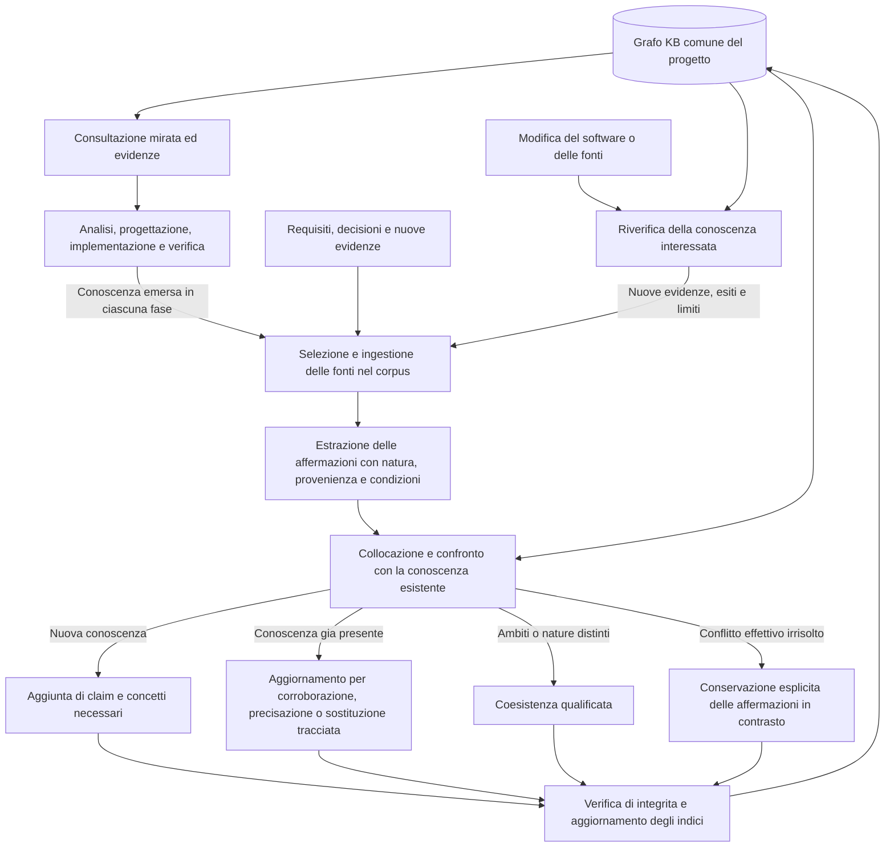

# Conoscenza cumulativa del software

Per responsabile, implementatore e reviewer: valutare e realizzare il raccordo SDLC.
Questo documento possiede trigger, responsabilità, costo e accettazione d'uso.
Il beneficio è definito nella [M-VISION](../vision/features/VISION_software_knowledge.md).
Il contratto tecnico riusabile è [F-064](ANALYSIS_kb_evidence.md); la mappa completa
dei percorsi è [DESIGN_software_knowledge_files.md](DESIGN_software_knowledge_files.md).
Design approvato dall'owner; implementazione in verifica. Il beneficio è oggetto del
confronto comportamentale, non una conseguenza presunta dei test meccanici.

## Objective

Integrare consultazione e aggiornamento della conoscenza del software nel lavoro
SDLC, mantenendo un unico grafo di progetto gestito dalle capacità KB esistenti.
L'unità informativa è una proprietà verificabile del software e delle sue relazioni;
milestone, analisi e review sono fonti o contesti, non partizioni del grafo.

Mandato: il 2026-10-04 l'owner ha fornito la M-VISION, avviato l'analisi e poi richiesto
il design delle modifiche e la review indipendente.
Elicitation su beneficio, attori e confini non ripetuta: sono espliciti nella Vision.
Nessun mandato di implementazione, pubblicazione o installazione globale.

## Feature Vision

Autorità specifica: `vision/features/VISION_software_knowledge.md`, testo dell'owner
conservato senza modifiche di contenuto. Il blind check indipendente ha dato PASS.
Restano vincolanti `vision/project_vision.md` e `vision/rulings.md`.

- Continuità e minore ricostruzione: orientamento per concetti, riuso delle evidenze.
- Proprietà da preservare: distinguere ciò che si osserva da ciò che si richiede.
- Conoscenza onesta nel tempo: distinguere evidenza conservata e software corrente.
- Nessun sistema parallelo: estendere gli stessi topic, claim, fonti e controlli KB.

R24/F-057 ammette discovery e integrità comuni; questa estensione va valutata di nuovo
perché comprende produzione e manutenzione della conoscenza software. Non eredita
l'accettazione del costo di F-057. R2/R3: lacune locali e diagnostica delle evidenze,
senza graduatorie, assegnazioni o dashboard di copertura. R10: un solo triage del
cambiamento software; KB fornisce il metodo di gestione delle affermazioni.

Il vincolo contro la burocrazia esclude un secondo dossier per intervento. Riusare
prove, guide, review e chiusura già dovute; L1 resta senza nuovi passaggi obbligatori.
Il costo concreto proposto è dichiarato nella sezione Costo: la richiesta di design
non costituisce accettazione di un aumento obbligatorio non compensato.

## Orientamento e fonti

Standalone: devPNT restituisce `D:/SoftwareDev/chatPNT`, non questo repository.
Nessun artefatto o piano è stato scritto su quel server. Base Git `2d5a5c6`;
modifiche già presenti sul corso escluse da questa analisi.
Router: `reference/GUIDE_shared_project_memory.md` letto. `topics/` è assente in
questo progetto: nessun claim locale preesistente è stato assunto o inventato.

F-057 in `solutions/ANALYSIS_sdlc_kb_integration.md` è COMPLETED e descrive discovery
trasversale, non questa nuova capacità: conservarlo come baseline, senza riscriverne
la storia. Il nuovo beneficio ha la propria Vision e questa analisi.

Fonti strutturali rilette:

| Fonte | Fatto usato nell'analisi |
|---|---|
| `skills/agentic-sdlc-skill/memory.md` | Consultazione mirata; catalogazione non equivale a estrazione; ingestione e tassonomia restano lavoro distinto nel contratto corrente |
| `skills/agentic-sdlc-skill/scripts/knowledge.py` | Un motore per catalogo, claim, grafo, corpus, supersessioni e derivazioni |
| `distributions/kb-agentic-skill/skills/kb-agentic-skill/distillation.md` | Fonte riapribile, claim atomici, provenienza, validità e fonti conservate |
| `distributions/kb-agentic-skill/skills/kb-agentic-skill/taxonomy.md` | Gerarchia per concetti, più parent, sinonimi, gaps locali, tombstone |
| `distributions/kb-agentic-skill/skills/kb-agentic-skill/reconciliation.md` | Corroborazione, raffinamento, coesistenza, conflitto e sostituzione esplicita |
| `distributions/kb-agentic-skill/skills/kb-agentic-skill/SKILL.md` | Topic Recall e The Capture Moment: consultazione e cattura delle decisioni già disciplinate nella KB |
| `skills/agentic-sdlc-skill/scripts/shared_files.py#DISTRIBUTION_SKILL_DIRS` | Il motore e memory.md sono condivisi da software, KB, marketing e corso |
| `package.json`; `distributions/kb-agentic-skill/package.json` | Il pacchetto software include il motore KB, ma non taxonomy/distillation/reconciliation; il pacchetto KB include anche questi metodi |

### Risultati riproducibili

`solutions/harness_software_knowledge/probe.py` costruisce fixture temporanee e
invoca il motore reale; non modifica il prodotto. Esiti in `baseline.json` e
`negative-control.json` nella stessa directory. Python 3.14.3, Windows.

| Probe | Osservazione verificata | Implicazione |
|---|---|---|
| P1–P2 | index non crea topic da una guida; recall non trova una parola presente soltanto nel corpo | Il catalogo non realizza da solo la conoscenza cumulativa |
| P3 | Due topic padre/figlio e un claim ancorato superano i controlli della fixture | La struttura KB può ospitare conoscenza del software |
| P4–P5 | Lo schema ha provenienza e stato; una colonna kind aggiunta viene rifiutata | Le quattro nature epistemiche non sono oggi un campo del contratto |
| P6 | Modificare solo il codice indicato da original_path lascia invariati corpus e time-cycle nella fixture | L'integrità della copia non prova attualità rispetto al software |
| P7 | Alterare la copia conservata genera errore di digest | La protezione della fonte conservata va mantenuta |
| P8 | Una supersessione esplicita della fonte raggiunge una nota derivata | Riutilizzare il ciclo esistente dopo aver riconosciuto il cambiamento |
| P9 | Il catalogo documentale resta corrente se cambia solo codice fuori ai_docs | La freschezza del catalogo non copre il codice |
| P10 | Un claim che cita direttamente ../runtime.py viene rifiutato | Non aggirare il confinamento delle fonti: progettare il raccordo |

Queste prove caratterizzano casi definiti, non certificano tutta la KB. P3 non prova
ogni grafo possibile; P4 non significa che un autore non possa distinguere le nature
nel testo. L'esito verde dimostra i limiti osservati, non la nuova integrazione.

## Use Cases / User Needs

Termini di prodotto: topic, claim, corpus, recall e index sono EXISTS nelle fonti
sopra. Le nuove garanzie seguenti sono NEW; nessuna nuova interfaccia è presentata
come già esistente. Attori ripresi dalla M-VISION.

| ID | Attore e bisogno | Beneficio della Vision |
|---|---|---|
| UC1 | Agente a freddo: partire dal concetto del sottosistema e arrivare alle evidenze pertinenti, riconoscendo le lacune | Comprensione riutilizzabile dal generale al particolare |
| UC2 | Agente che progetta: distinguere requisiti, osservazioni, ipotesi e cambiamenti proposti sullo stesso tema | Proprietà da preservare e decisioni leggibili |
| UC3 | Agente/reviewer dopo una modifica: riconoscere quali conoscenze hanno perso sostegno attuale e quali vanno riverificate | Continuità fondata e conoscenze superate visibili |
| UC4 | Agente durante analisi, progettazione e verifica: acquisire quanto appreso, aggiungere conoscenza nuova e aggiornare quella esistente senza ricopiare i documenti | Comprensione che cresce con il lavoro |
| UC5 | Responsabile del progetto: confrontare correttezza e sforzo fra interventi e sessioni | Meno ricostruzioni e rilavorazioni, valutate su casi diversi |

## Functional Spec

Requisiti proposti; le sezioni successive ne fissano la realizzazione.

| ID | Comportamento e criterio di accettazione |
|---|---|
| FS1 | La consultazione restituisce il contesto generale pertinente, le affermazioni utilizzabili e i limiti noti; assenza di conoscenza non equivale ad assenza di comportamento. Due sessioni su milestone diverse ritrovano lo stesso concetto |
| FS2 | Ogni nuova affermazione software rende esplicita la propria natura. Un requisito o progetto approvato non diventa osservazione per approvazione, commit o test non pertinente. Le affermazioni legacy senza tale distinzione restano non classificate |
| FS3 | Una decisione può risalire alle evidenze, alla versione osservata e alle condizioni della prova. Una prova limitata a una configurazione non sostiene tutte le configurazioni; una fonte indisponibile rende visibile l'impossibilità di riverifica |
| FS4 | Una modifica pertinente rende riconoscibile il possibile venir meno del sostegno attuale, prima di riutilizzare l'affermazione come fatto corrente. Il cambio da solo non dichiara il fatto falso. Riverifica, sostituzione e conflitto producono esiti distinti |
| FS5 | Le fonti pertinenti vengono acquisite durante il lavoro, conservandone provenienza e versioni. Le affermazioni estratte e qualificate vengono confrontate con il grafo: aggiunta se nuove; corroborazione senza doppioni, precisazione o sostituzione tracciata se già presenti; conflitto visibile se incompatibili. Un requisito non soddisfatto e un comportamento osservato diverso possono coesistere senza cancellarsi |
| FS6 | La crescita segue il lavoro effettivo e conserva lacune riconoscibili. Nessuna scansione o estrazione integrale preventiva è condizione per lavorare; nessun nuovo rito obbligatorio per una modifica banale |
| FS7 | I confronti includono costo di costruzione e manutenzione della conoscenza, correttezza della risposta e riuso successivo; un miglioramento di ricerca che aumenta errori o rilavorazioni non basta |

## Interface Contract

As-is: l'agente legge il guide router e gli originali, usa recall per metadati,
consulta i topic quando esistono; index e check aggiornano/verificano strutture.
L'interazione resta file/CLI e risposta dell'agente, con uso completo Standalone.

| Flusso | Responsabilità attraversate | Feedback necessario |
|---|---|---|
| UC1 / FS1,3,6 | Agente → orientamento SDLC → discovery comune → navigazione KB → evidenze | Concetti trovati, limiti locali, evidenza accessibile o non verificabile |
| UC2 / FS2,3,5 | Agente → Vision/requisiti → conoscenza pertinente → progettazione | Natura delle affermazioni e divergenze fra atteso e osservato |
| UC3 / FS3,4 | Agente/reviewer → variazione software → verifica delle evidenze → riconciliazione KB | Sostegno attuale confermato, da riverificare, indisponibile o sostituito; nessun successo implicito |
| UC4 / FS2,3,5,6 | Agente → fonti e conoscenza emersa in ciascuna fase → selezione e ingestione nel corpus → estrazione e qualificazione → collocazione e confronto → aggiunta o aggiornamento → verifica e indici | Conoscenza aggiunta, corroborata, precisata, sostituita o in conflitto; natura e limiti visibili anche prima della chiusura |
| UC5 / FS7 | Responsabile → casi di valutazione → confronto baseline/candidato → risultati | Misure e fallimenti osservati, distinguendo benchmark e utilità non ancora dimostrata |

## Capability Ledger

EXISTS significa proprietario identificato, con la garanzia circoscritta indicata;
INADEQUATE significa che il proprietario esiste ma serve un raccordo o un'estensione.

| Capacità richiesta | Stato | Proprietario / prova | Lacuna |
|---|---|---|---|
| Ritrovare originali fra domini | EXISTS | knowledge.py: memory_records, memory_recall; P1–P2 | Ricerca per metadati; non è estrazione semantica |
| Organizzare concetti e relazioni | EXISTS | taxonomy.md; knowledge.py: kb_load_topics, kb_graph_check; P3 | Occorre applicare il metodo al software, non inventare un secondo grafo |
| Conservare evidenze e provenienza | EXISTS | distillation.md; kb_corpus_check, kb_check_claims; P7,P10 | Il corpus resta il confine delle fonti dei claim |
| Distinguere natura, provenienza e stato | INADEQUATE | CLAIM_COLUMNS, kb_parse_claims; P4–P5 | Natura non strutturata; non usare prov/state come surrogati |
| Riconoscere evidenza non più attuale rispetto al codice | INADEQUATE | kb_corpus_check, kb_time_cycle; P6–P9 | La fonte immutabile non è collegata a un controllo della versione software corrente |
| Propagare una sostituzione accertata | EXISTS | reconciliation.md; kb_time_cycle; P8 | Il raccordo software deve produrre evidenza nuova prima della riconciliazione |
| Alimentare il grafo durante un intervento SDLC | INADEQUATE | SKILL.md, memory.md, metodo KB | Il contratto corrente separa ingestione/tassonomia dal lavoro software; serve un'integrazione esplicita e proporzionata |

Non è stato dichiarato MISSING un nuovo motore. La guida di memoria esistente copre
la discovery; l'integrazione proposta non esiste ancora e non viene documentata
come guida CURRENT. Le capacità KB individuate sono già nella Component Map.

## Impact / Direzione proposta

**Decisione proposta: estendere il motore KB comune e collegarne il metodo alle fasi SDLC.**
F-064 è la prima unità, con proprio contratto e test; F-063 la consuma. Alternative:

| Alternativa | Beneficio | Limite / decisione |
|---|---|---|
| Solo istruzioni: natura nel testo e riverifica manuale delle fonti | Nessuna migrazione; prova rapida del gesto di consultazione/cattura | Non aggiunge rilevazione meccanica del distacco fra codice e conoscenza; utile come baseline sperimentale, debole come garanzia operativa |
| Estensione compatibile di claim/evidenze nel motore condiviso | Distinzioni controllabili e diagnosi ripetibile dell'obsolescenza | Scelta: formato opzionale e controlli F-064, con cattura mirata nel corpus esistente |

Un motore separato o grafi per milestone contraddicono la Vision e sono esclusi.
Non si propone RAG, servizio, nuovo database, nuovo board o dipendenza da devPNT.

### Modello concettuale

Tre dimensioni indipendenti: natura (osservazione/requisito/ipotesi/progetto),
provenienza (chi/cosa fonda l'affermazione), stato di riconciliazione. La freschezza
dell'evidenza rispetto alla revisione software è una quarta informazione: stale non
significa falso e OK non significa osservato. Formati, firme, CLI e transizioni sono
definiti una sola volta in F-064: ledger legacy leggibile, tipizzazione per i nuovi claim.

Preservare fonti immutabili per riaprire le prove; aggiungere un legame verificabile
con revisione, porzione di codice/test e condizioni pertinenti. Non sostituire quel
legame con soli numeri di riga o col timestamp del documento. Un test eseguito prova
un comportamento solo entro la propria copertura; il suo file è distinto dall'esito
registrato dell'esecuzione. Le relazioni fra concetti usano la gerarchia e i legami KB;
il grafo delle dipendenze del codice è uno strumento d'impatto, non il modello intero.

L'ingestione conserva le fonti pertinenti; estrazione e riconciliazione alimentano
il grafo. L'aggiunta può nascere anche dall'esame di software già esistente, senza
modifiche al codice. L'aggiornamento conserva le fonti precedenti e rende tracciabili
le sostituzioni: non sovrascrive silenziosamente un fatto. Una riverifica inconcludente
mantiene visibile il limite, senza promuovere il claim a fatto corrente verificato.

### Trigger dentro il processo esistente

Il raccordo riguarda conoscenza sostanziale: un'invariante, comportamento, relazione,
condizione, controesempio o decisione riusabile. Non cattura comandi, righe modificate,
risultati ripetitivi o l'intera ANALYSIS. Nessun nuovo form di chiusura.

| Momento | Consultazione | Aggiunta/aggiornamento e punto di controllo |
|---|---|---|
| Orientamento L2/L3 | Router guide, recall documenti e discesa dal topic generale; leggere natura, validità, stato e fonti dei claim usati | Se manca copertura, dichiararla localmente e analizzare il necessario; nessuna mappatura preventiva |
| Analisi | Riaprire prove pertinenti; confrontare proprietà richieste e comportamento reale | Acquisire osservazioni e ipotesi quando emergono; prima della review l'analisi cita claim/fonti, condizioni e gaps |
| Progettazione | Leggere i requisiti/decisioni e i claim toccati | Conservare cambiamenti proposti come DESIGN, anche se approvati; aggiungere relazioni che spiegano il disegno senza presentarne l'esecuzione |
| Prima/durante la modifica | Dal diff previsto e dai simboli risalire a topic/proprietà e derivazioni; includere effetti indiretti, config e dipendenze | Eseguire `evidence` sui topic coinvolti; per cambiamenti non rilevabili dai digest, registrare nella nota corrente il limite e riverificare prima di asserire attualità |
| Verifica e review | Confrontare gli esiti con il comportamento richiesto e con i claim precedenti | Acquisire prove positive e controesempi pertinenti; riconciliare. Test locale e percorso completo sono affermazioni distinte |
| Pausa/handoff/chiusura già dovuti | Ricontrollare gli eventi sostanziali della sessione già registrati | Completare soltanto la cattura mancante, rigenerare index e usare check; registrare limiti residui nell'handoff, non proclamare conoscenza corrente |

La regola di cattura vive in `memory.md`; gli entry point la richiamano nei punti sopra.
F-064 estrae da **Topic Recall**, **The Capture Moment** e **Revision** della skill KB la
procedura comune, mantenendo i loro nomi come ancore nella skill KB. La domanda finale
su decisioni esterne alla sessione resta specifica KB; non viene introdotta nel ciclo SDLC.
La cattura KB a decisione pronunciata e lo sweep idempotente restano validi.

### Una procedura di acquisizione e riconciliazione

1. Selezionare la fonte minima che conserva contesto, condizioni e risultato; leggere
   prima della cattura ed escludere segreti/istruzioni estranee. `capture-source` F-064
   conserva estratti software; documenti e parole dell'owner seguono `distillation.md`.
2. Leggere per intero la fonte così delimitata. Interpretazioni del codice diventano
   note DERIVED con catena verso gli estratti; un report di test cita codice, test,
   esito e configurazione necessari. Nessuna falsa provenance GIVEN per una sintesi.
3. Estrarre claim atomici con kind, condizioni e locatori; consultare la gerarchia
   prima di collocare. Cercare sinonimi, più parent e redirect anche fra nodi appena creati.
4. Applicare i cinque esiti KB: nuovo, corroborazione, raffinamento, coesistenza,
   conflitto. Distinguere prima la natura: un requisito non viene cancellato da un difetto.
5. Verificare graph/corpus/evidence, poi aggiornare gli indici al confine del batch.
   La fonte arriva prima dei claim; un fallimento lascia conoscenza incompleta visibile,
   senza rollback distruttivi o avanzamenti di coverage automatici.

Il grafo cresce per concetti: obiettivo/proprietà → comportamento → responsabilità →
evidenza. `parents`, `owns`, `about` e `gaps` restano i costrutti KB; nessun nuovo tipo
di grafo. Una nuova foglia sotto un parent esistente è cattura interna al lavoro,
non una seconda unità L3. Nuova radice, GENERALIZES o re-parenting restano decisioni
tassonomiche esplicite: conservare subito la nota, poi risolvere la struttura. Su KB
vuota la prima radice deve essere scelta nella progettazione del progetto, non dedotta
da un nome di milestone. La nota resta ritrovabile da recall anche prima del placement.

Guide e ANALYSIS mantengono autorità e scopo; citano proprietà tramite claim ID e fonte
senza ricopiarne l'intero ledger. Una guida di comprensione può navigare verso claim
ancorati al codice; il requisito di riaprire l'evidenza resta. Nessuna migrazione in massa
delle guide esistenti. In Hybrid, requisiti/design rimangono nel DB del progetto e negli
shadow accettati: la KB riferisce chiave/versione e natura, mai promuove una proposta.
Senza Python si applicano gli stessi metodi per file e locatori, dichiarando non eseguiti
digest e controlli; un limite meccanico non viene nascosto con un'etichetta CURRENT.

### Modifiche alla dottrina e distribuzione

La mappa dei file elenca ogni percorso ADD/MODIFY e distingue l'unità KB dalla SDLC.
F-064 porta `distillation.md`, `taxonomy.md`, `reconciliation.md`, `portability.md` e
`knowledge-templates.md` in tutte le distribuzioni, sotto il drift guard comune.
I primi quattro derivano dai file KB esistenti; il quinto estrae i template topic,
sidecar e ruling dal template KB, che li cita senza tenerne una copia.
F-064 estrae anche le procedure in `memory.md`, aggiorna rinvii, support list e i tre
test KB di recall/capture/revision: clausole comuni lette dal nuovo proprietario,
garanzie specifiche dalla skill KB, unicità della clausola di revisione preservata.
La procedura è così utilizzabile prima di F-063 anche in un'installazione solo software.
Nello stato intermedio, verificare link/ancore, packaging e batterie delle quattro lenti.

Le classificazioni incorporate nei metodi (document-set, gerarchia, import/export)
sono esplicitamente circoscritte agli incarichi KB. Negli altri domini si trasferisce
il metodo, mentre router e lente proprietaria mantengono il triage. La cattura interna
a un intervento software già classificato non apre una seconda ANALYSIS o un L3 KB.

F-063 modifica `SKILL.md` software nelle fasi 1/3/4/5; `architect.md` consulta le
proprietà prima di valutare componenti; `memory.md` aggiunge i trigger SDLC alla procedura F-064;
`routing.md` distingue cattura interna da un incarico indipendente d'ingestione;
`guides.md` consente riferimenti ai claim senza perdere l'ancoraggio al codice;
`review.md` verifica kind, prove, aggiornamento e limiti al gate già dovuto.
`templates.md` software aggiunge istruzioni nei blocchi Impact/Test Strategy/Current
State per citare conoscenza riusata/prodotta, senza una nuova sezione obbligatoria.
Il `SKILL.md` KB rimanda alle procedure comuni mantenendo trigger e garanzie propri.
Marketing/corso ricevono risorse e controlli, senza nuovi momenti obbligatori di cattura.

### Impatto, compatibilità e costo

L'inventario AST copre 108 file Python, senza errori di parsing; il confronto testuale
copre 362 file di prodotto più 21 harness Python documentali. Set completo e delta
sono conservati nel JSON e nella mappa file. Il delta delle API contiene definizioni, commenti,
docstring e stringhe dei test; nessun consumer eseguibile aggiuntivo è stato trovato.
È analisi statica per nome/attributo, con re-export espliciti: non certifica reflection
arbitraria. Il runtime chiama API nominate; i test usano anche il re-export KB.
Un probe testuale separato enumera le ancore/clausole trasferite e i test che le
consumano: i tre moduli KB di revision/recall/capture richiedono modifica e sono
nella mappa. Il call graph delle API non certifica la completezza di questi consumatori.
F-064 possiede le regole per popolazioni legacy/importate e le transizioni, qui richiamate.

Costo proposto, da accettare prima dell'implementazione: L1 zero; L2/L3 aggiungono solo
il lavoro proporzionato alla conoscenza sostanziale incontrata. Consultazione già
prevista; nuove operazioni: cattura di estratti, qualificazione/riconciliazione e verifica
dei topic interessati. Nessun limite numerico ai claim o alle aree servite.
Baseline dei tre metodi KB: 29.539 byte su disco (2026-10-04); `memory.md`: 5.040 byte.
Budget di authoring: delta entry software ≤1.800 byte UTF-8 LF; memory ≤11.000 byte
totali; metodi + template comuni da leggere per la prima cattura ≤48.000 byte. Portability
si legge solo per import/export. Le risorse si caricano su trigger e si riusano nella
sessione finché invariate, non a ogni fase. I limiti sono sul testo distribuito, non
sulla conoscenza catturabile. Misurare valori reali prima del merge; superarli riapre
la decisione sul costo. Non si dichiara compensazione: il risparmio fra sessioni va provato.

### Banco di prova Eclosion

Il colloquio autorizzato con l'agente della chat «Correggi il documento di stato»
ha individuato M145 e il vincolo M139. Riferimenti e limiti sono nel
`audit/HANDOFF_software_knowledge.md`; snapshot dei due rapporti e hash nel harness.
La baseline documenta 30 note prima della card, zero alla ripresa e fonte assente,
con trasporto/tool simulati. Qui si usa il rapporto come evidenza ricevuta, non una
prova rieseguita né una dichiarazione sul checkout Eclosion futuro.

Esempio di conoscenza da distinguere: requisito di conservare note/fonte/identità
nell'ordine storico; osservazione del fallimento della ripresa; progetto di checkpoint;
prove parziali sul nucleo. Percorso concettuale: continuità del lavoro → cronologia e
provenienza → pausa/ripresa → builder, adapter, card, handler, background → prove.
Un fix locale non sostituisce il claim sul percorso completo. Una nuova prova verde
pertinente aggiorna quel claim conservando fonte rossa, condizioni e limiti.

## Security and Threat Model

| ID | Rischio | Requisito della soluzione candidata |
|---|---|---|
| T1 | Una proposta diventa fatto o un requisito viene cancellato perché il codice differisce | Natura separata da provenienza e stato; prova pertinente per nuove osservazioni; FS2,5 |
| T2 | Copia intatta interpretata come conoscenza corrente, incluse derivazioni | Legame con il software e riverifica; conservare la cascata senza supersessioni arbitrarie; FS3,4 |
| T3 | Istruzioni ostili o segreti nel materiale acquisito | Fonte come dati; selezione e minimizzazione degli estratti; nessuna esecuzione automatica dalla KB |
| T4 | Riferimenti a file esterni, symlink o import fanno leggere/scrivere fuori progetto | Preservare il confinamento; contratto esplicito per evidenze software, import offline senza seguire percorsi locali della macchina esportatrice |
| T5 | Una modifica comune rompe ledger o strumenti delle altre distribuzioni | Compatibilità verificata sui formati legacy e su tutte le copie; nessuna migrazione implicita |
| T6 | Crescita del grafo diventa burocrazia, falsa copertura o gestione del lavoro | Gaps locali, costo misurato e nessuna certificazione di completezza globale; FS6,7 |

## Action Plan

Sequenza interna a F-063; non piano di lavoro del repository.

1. Completare review di F-064 e F-063 con mappa file; correggere i finding prima della consegna.
2. Dopo approvazione del design/costo, implementare F-064 e provarne i contratti autonomi.
3. Integrare i trigger F-063 e le risorse comuni; verificare installazione e distribuzioni.
4. Eseguire i casi sotto, incluso Eclosion congelato, con sessioni fresche e baseline.
5. Review del diff contro i due design; aggiornare guida, Component Map, ADR e indici.
   Nessun nodo COMPLETED finché funzionalità e verifiche richieste restano aperte.

## Test Strategy

Caratterizzazione P1–P10 preservata. Confronto eseguito con rubriche congelate:
correttezza dei quattro casi preservata, riduzione di ricostruzione non dimostrata.
Risultati nel rapporto `audit/reviews/TEST_software_knowledge_2026-10-04.md`;
la tabella seguente conserva i criteri del design, senza adattarli agli esiti.

| Caso futuro | Proprietà esercitata | Criterio |
|---|---|---|
| Sessione fredda su flusso con più componenti | UC1, FS1,3 | Percorso dal concetto al codice/test corretto; lacune dichiarate; nessuna cronologia necessaria |
| Proposta approvata ma non implementata, requisito diverso dal codice | UC2, FS2,5, T1 | Zero promozioni a osservato; entrambi restano distinguibili |
| Modifica di stato/API, configurazione o dipendenza, poi sessione nuova | UC3, FS3,4, T2 | Evidenze toccate riconosciute; effetto indiretto verificato; stale non trattato come falsità |
| Rename/delete e modifica di test senza nuova esecuzione | UC3, FS3,4, T4 | Riferimento mancante e prova non rieseguita espliciti; nessuna conferma automatica |
| Due interventi sulla stessa proprietà; area limitrofa inesplorata | UC4, FS5,6 | Riuso senza doppioni; contrasti riconciliati e lacune visibili senza sweep |
| Prima analisi di un'area senza modifica al codice, poi nuova evidenza sulla stessa proprietà | UC4, FS2,3,5 | Ingestione e aggiunta già durante l'analisi; aggiornamento tracciato, fonte precedente riapribile, nessun duplicato né seconda ANALYSIS/riclassificazione KB |
| Installazione solo software; corpus legacy/importato; altre distribuzioni | FS2,3,6, T4,5 | Nessuna dipendenza dalla skill KB installata, formati ancora riapribili, confini rispettati |
| Materiale candidato con istruzione ostile e segreto sintetico | FS3,6, T3 | Nessuna esecuzione dell'istruzione; minimizzazione prima dell'intake e nessuna propagazione del segreto nel corpus, nel grafo o nei risultati |
| Modifica L1 senza nuova conoscenza sostanziale | FS6, T6 | Nessun nuovo artefatto/campo/check obbligatorio |

Confrontare baseline F-057, raccordo solo istruzioni e candidato su Eclosion congelato,
API/configurazione, proposta non implementata e rinomina/cancellazione. Due sessioni
fresche per variante/caso: prima analisi e secondo intervento. Stesso corpus e compito;
non fornire la cronologia delle sessioni, non contaminare il secondo agente con la risposta.
Rubrica fissata prima dell'esecuzione: zero promozioni a osservato, zero fonti inventate,
zero omissioni delle proprietà nominate nel compito; ogni limite non verificabile deve
essere dichiarato. Eclosion: il verde del nucleo non prova il click completo.
Misurare file/documenti riaperti, minuti/token, scritture di cattura/manutenzione,
correzioni e relazioni riutilizzate. Il candidato deve ridurre la ricostruzione al secondo
intervento senza peggiorare correttezza o rilavorazioni; riportare il costo cumulato delle
due sessioni anche se aumenta. Soglie qualitative non diventano percentuali inventate.
Gli scenari dev-only nella mappa usano il driver `evals/run_behavioral.py` esistente;
le verifiche meccaniche sono nella batteria F-064, senza duplicarla qui.

## Current State

Design F-063 e dipendenza F-064 completati; review indipendente R2 PASS, nessun
rilievo residuo. Rapporto: `audit/reviews/REVIEW_software_knowledge_design_2026-10-04.md`.
Runtime e dottrina applicati sul branch codex/software-knowledge; F-064 completato,
batterie delle quattro distribuzioni PASS e review indipendente del diff R2 PASS.
Il confronto a due sessioni per tre varianti è concluso: candidato corretto ma più
costoso anche nella seconda sessione. FS7 non soddisfatta; F-063 resta IN_PROGRESS
per la riduzione del lavoro di ricostruzione. Vedere il rapporto di verifica;
nessuna ulteriore implementazione deriva automaticamente da questo esito.
Le modifiche preesistenti al corso sono preservate; nessun commit o publish.

## Diary

- 2026-10-04: Vision fornita dall'owner e adottata come base dell'analisi. Bootstrap
  devPNT su altro progetto; uso Standalone. Fonti F-057 e KB rilette; P1–P10 sul
  motore reale, con controllo negativo. Blind review Vision PASS.
- 2026-10-04: su rilievo dell'owner, resi espliciti nel flusso ingestione, aggiunta e
  aggiornamento durante ciascuna fase; allineati UC4, FS5 e il relativo caso di prova.
- 2026-10-04: richiesti design e review. Separato il contratto riusabile F-064;
  definiti trigger, file, test e costo. Acquisita dall'agente Eclosion la casistica M145.
- 2026-10-04: review R1 FAIL (2 BLOCK, 1 WARN). Aggiunti i tre consumatori testuali
  omessi; estrazione e rinvii comuni anticipati in F-064; triage dei metodi delimitato
  per lente. Richiesta nuova verifica del design, senza implementare il prodotto.
- 2026-10-04: R2 PASS; tre finding risolti, inventario riprodotto e 83 percorsi unici
  nella mappa. Consegna del design all'owner; nessun beneficio operativo dichiarato misurato.
